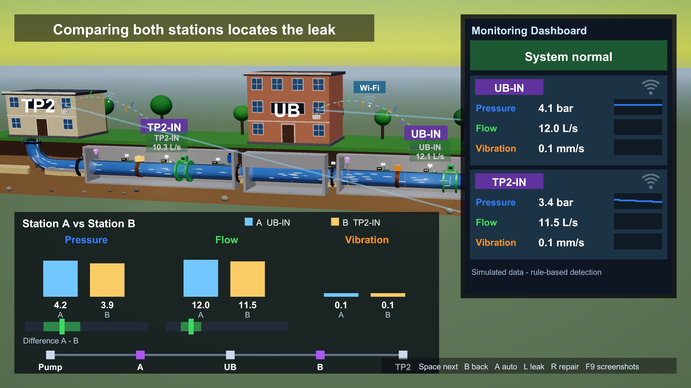
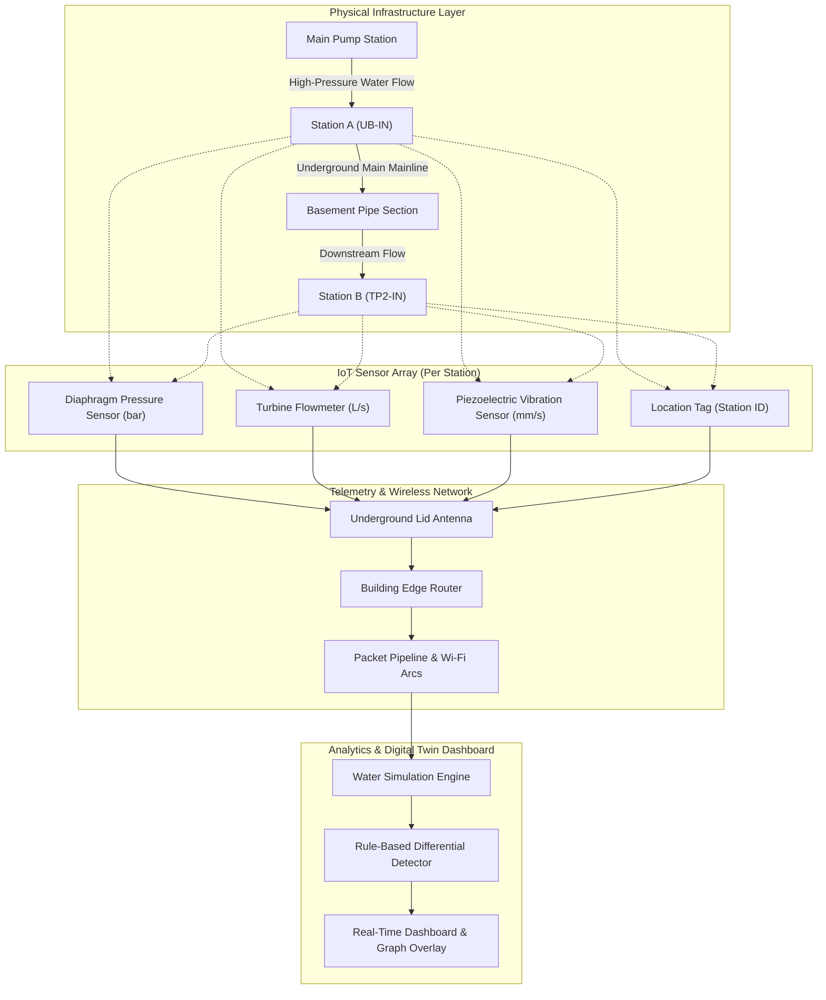
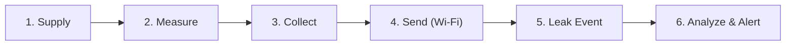
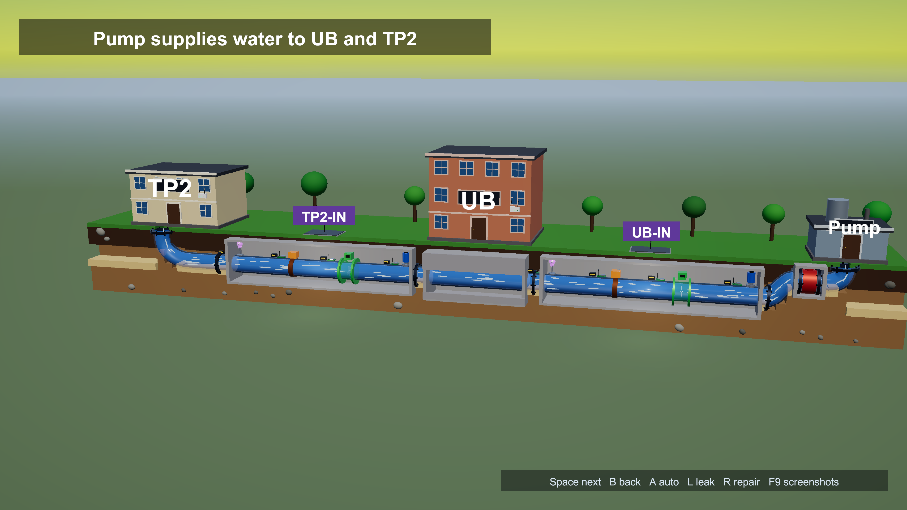
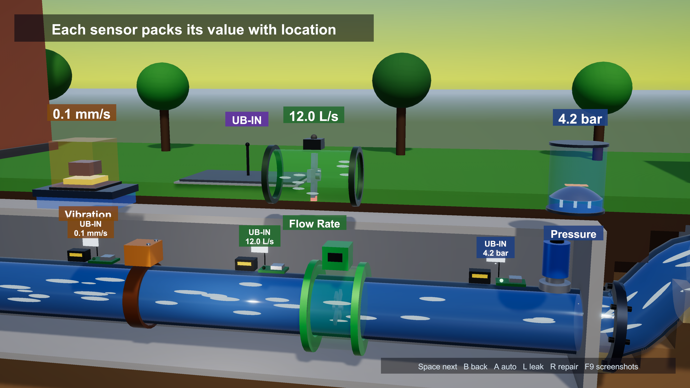
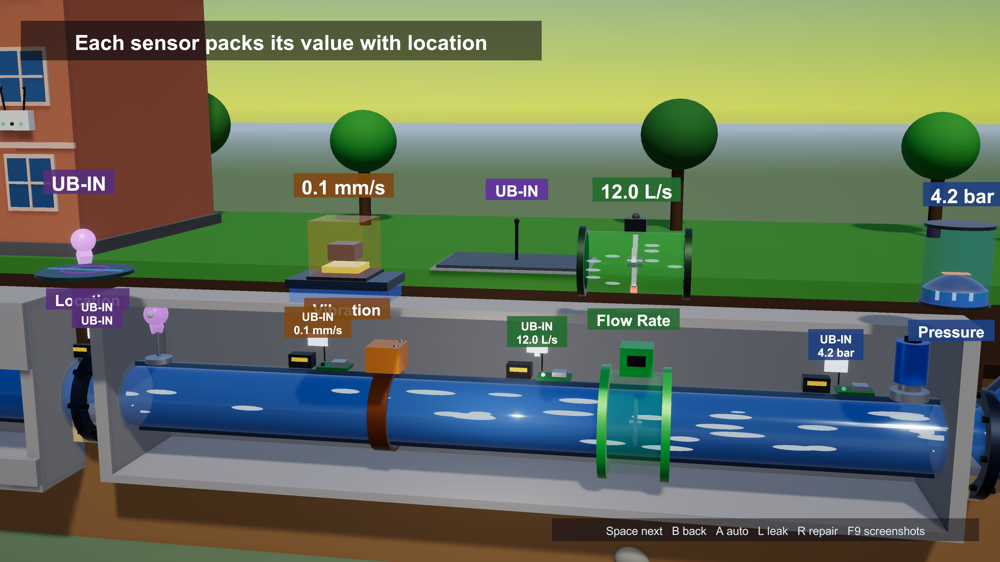
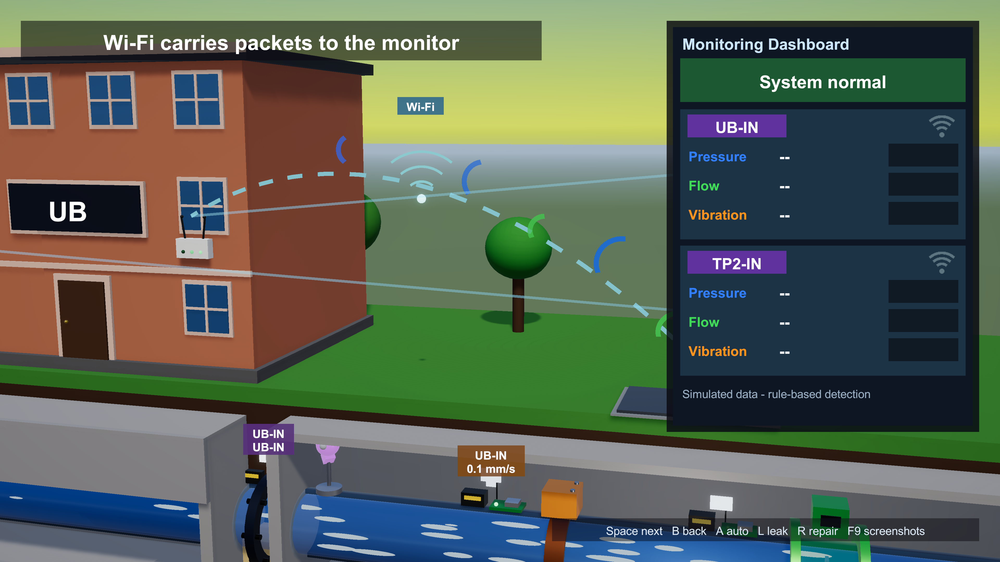
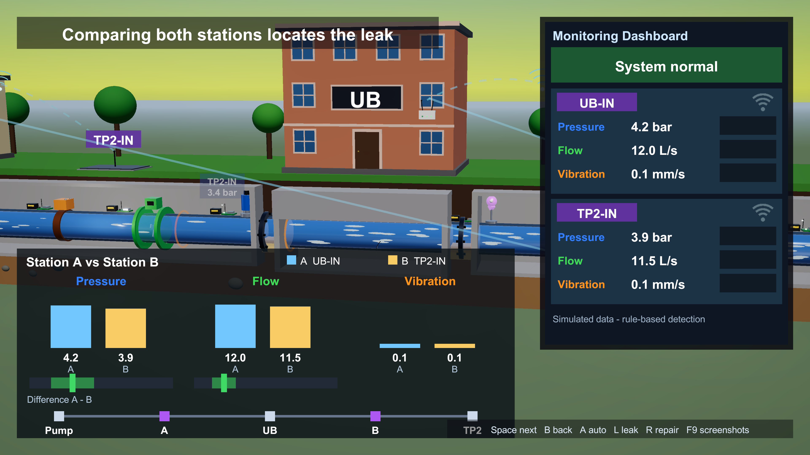

# 🌊 AquaTwin-3D

<div align="center">

[-black?style=for-the-badge&logo=unity)](https://unity.com/)
[](https://unity.com/srp/universal-render-pipeline)
[](https://docs.microsoft.com/en-us/dotnet/csharp/)
[]()
[]()
[](LICENSE)

**An interactive real-time 3D Digital Twin and IoT telemetry simulation for municipal water infrastructure, featuring procedural mesh generation, wireless packet pipelines, and rule-based differential leak localization.**

<br/>



<br/>

[Overview](#-overview) • [Core Engineering](#-core-engineering-features) • [System Architecture](#-system-architecture) • [Telemetry Specifications](#-telemetry--sensor-specifications) • [Narrative Tour](#-6-stage-guided-tour) • [Getting Started](#-getting-started)

</div>

---

## 📌 Overview

Municipal and industrial water pipelines are predominantly underground, making visual inspection and early leak identification difficult and costly. Unidentified leaks lead to catastrophic infrastructure erosion, financial loss, and severe water waste.

**AquaTwin-3D** addresses this challenge through a **real-time 3D Digital Twin**:
* It models an end-to-end municipal distribution network from a central pump station to multiple buildings (**UB** and **TP2**).
* It deploys simulated multi-sensor telemetry nodes measuring **hydrostatic pressure**, **volumetric flow rate**, and **pipe wall vibration**.
* It simulates wireless packet transmission over Wi-Fi to edge routers and a central telemetry dashboard.
* It implements a **differential anomaly detection algorithm** that compares live sensor telemetry against dynamic baseline drops to isolate and pinpoint the exact pipeline segment experiencing failure.

---

## ⚡ Core Engineering Features

### 1. 100% Procedural 3D Mesh Generation (Zero Asset Bloat)
Unlike typical 3D projects that rely on gigabytes of pre-baked 3D models (`.fbx`/`.obj`), AquaTwin-3D builds the entire world **procedurally at runtime in C#**:
* **Parametric Curve Paths**: Calculates continuous 3D coordinate paths with tangent vector evaluation (`CurvePath.cs`).
* **Dynamic Tube Mesh Extrusion**: Computes rotating parallel transport frames using `Quaternion.FromToRotation` to smoothly sweep circular cross-sections along 3D splines (`MeshBuilder.cs`).
* **Winding & Normal Correction**: Dynamic polygon quad and triangle winding calculation based on normal dot-product orientation.
* **Procedural Textures & Shaders**: Runtime texture generation and material emission setups via `TextureFactory.cs` and `MaterialFactory.cs`.

### 2. Multi-Sensor IoT Telemetry Engine
Simulates real-world sensor physics and data ingestion:
* **Sensor Sampling Loop**: Runs an event-driven telemetry stream (`OnSample`) with realistic Gaussian sensor noise and calibration drift.
* **Telemetry Packet Pipeline**: Visualizes wireless data transmission with animated Wi-Fi wavefronts from underground chamber antennas to building edge routers.
* **Decoupled Architecture**: State and simulation models are completely separated from rendering, camera, and UI presentation layers (`Ctx.cs` state container).

### 3. Differential Anomaly & Leak Localization Algorithm
The system utilizes continuous differential comparison across monitoring stations:
$$\Delta P = P_A - P_B \quad\text{and}\quad \Delta Q = Q_A - Q_B$$
* **Baseline Compensation**: Normal pipe friction and building consumption create natural drops ($\text{Baseline}_{\Delta P} = 0.3\,\text{bar}$, $\text{Baseline}_{\Delta Q} = 0.5\,\text{L/s}$).
* **Multi-Sensor Consensus Filter**: An alert is only triggered when pressure drop, flow discrepancy, and high-frequency vibration spike simultaneously.
* **Hysteresis Filtering**: Employs consecutive agreement counters (`agreeStreak` $\ge 2$) to eliminate false positives from transient hydraulic spikes.

---

## 🏗 System Architecture



---

## 📊 Telemetry & Sensor Specifications

Each telemetry station houses four dedicated telemetry channels:

| Sensor | Mechanism | Normal Baseline | Under Leak Condition |
| :--- | :--- | :--- | :--- |
| **Pressure** | Thin diaphragm with strain gauge transducer | $4.2\,\text{bar}$ (A) / $3.9\,\text{bar}$ (B) | Drops downstream ($3.4\,\text{bar}$ at B) |
| **Flow Rate** | Inline turbine with Hall-effect magnetic pickup | $12.0\,\text{L/s}$ (A) / $11.5\,\text{L/s}$ (B) | Diverges ($12.1\,\text{L/s}$ at A vs $10.3\,\text{L/s}$ at B) |
| **Vibration** | Piezoelectric crystal accelerometer | $0.1\,\text{mm/s}$ (Laminar) | Spikes to $0.6 - 0.9\,\text{mm/s}$ (Turbulent spray) |
| **Location Tag**| Station cryptographic identifier | `UB-IN` / `TP2-IN` | Unaltered (Metadata packet origin) |

---

## 🎬 6-Stage Guided Tour

The simulation features an automated, cinematic narrative presentation tour controlled by `StoryController.cs`:



1. **Supply**: Camera introduces the campus pipeline connecting the central pump station to UB and TP2 buildings.
2. **Measure**: Close-up inspection of Station A; camera glides past each sensor displaying working mechanical animations and real-time pop-out readouts.
3. **Collect**: Highlights wireless self-contained modules; sensor LEDs blink as readings are bundled into timestamped data packets.
4. **Send**: Wi-Fi pulses arc across the sky from chamber antennas to building routers; telemetry cards pulse with every received packet.
5. **Leak Event**: Lower basement wall is cut away revealing a hairline crack, thin spray jet, and accumulating puddle, with acoustic vibration waves rippling down the pipe.
6. **Analyze & Alert**: Differential comparison displays pressure and flow deviating from normal thresholds into red danger zones; system pins the fault directly to the UB sector.

---

## 🎮 Interactive Controls

| Key | Action | Description |
| :---: | :--- | :--- |
| <kbd>Space</kbd> | **Next Scene** | Advance forward to the next cinematic tour scene |
| <kbd>B</kbd> | **Previous Scene** | Step backward to the previous scene |
| <kbd>A</kbd> | **Toggle Autoplay** | Pause / resume automated presentation progression |
| <kbd>L</kbd> | **Simulate Leak** | Manually initiate pipe rupture and fluid spray |
| <kbd>R</kbd> | **Repair Pipeline** | Restore pipeline integrity and return readings to normal |
| <kbd>F9</kbd> | **Screenshot Tour** | Automatically captures high-resolution PNGs of all 6 scenes |

---

## 📁 Repository Anatomy

```text
AquaTwin-3D/
├── Assets/
│   └── LeakWatch/
│       └── Scripts/
│           ├── Core/         # Bootstrap, Material/Texture factories, runtime Ctx state
│           ├── Geometry/     # MeshBuilder, procedural TubeMesh, 3D spline math
│           ├── World/        # Procedural buildings, ground, pipes, router, lighting
│           ├── Sensors/      # StationBuilder, sensor exhibit views & animators
│           ├── Simulation/   # Water physics simulation, noise models, leak detector
│           ├── Telemetry/    # Wi-Fi packet pipeline, transmitter arcs, data link
│           ├── Story/        # 6-scene story controller, camera rig transitions, screenshot tour
│           ├── UI/           # DashboardUI, live line graphs, HUD, world-space labels
│           └── Camera/       # Smooth target-tracking cinematic camera rig
├── Packages/                 # Package manifests (Unity 6 URP, Input System)
├── ProjectSettings/          # Graphics, quality, and pipeline configurations
└── README.md
```

---

## 🚀 Getting Started

### Prerequisites
* **Unity**: Version `6000.0.80f1` (Unity 6) or higher.
* **Render Pipeline**: Universal Render Pipeline (URP).
* **OS**: Windows, macOS, or Linux.

### Setup Instructions
1. **Clone the repository**:
   ```bash
   git clone https://github.com/Ranaprince19/AquaTwin-3D.git
   ```
2. **Open in Unity Hub**:
   - Open **Unity Hub** &rarr; click **Add** &rarr; select the `AquaTwin-3D` folder.
3. **Launch the Scene**:
   - Navigate to `Assets/Scenes/SampleScene.unity`.
   - Press **Play** in the Unity Editor.
   - The digital twin simulation will start automatically!

---

## 📸 System Showcase

<div align="center">
  <table>
    <tr>
      <td width="50%">
        <p align="center"><b>1. Pipeline Supply & Campus Mainline</b></p>
        
      </td>
      <td width="50%">
        <p align="center"><b>2. 4-Channel Sensor Station (UB-IN)</b></p>
        
      </td>
    </tr>
    <tr>
      <td width="50%">
        <p align="center"><b>3. Wireless Module Packet Assembly</b></p>
        
      </td>
      <td width="50%">
        <p align="center"><b>4. Wi-Fi Arcs & Edge Router Ingestion</b></p>
        
      </td>
    </tr>
    <tr>
      <td width="50%">
        <p align="center"><b>5. Pipeline Rupture & Leak Jet Dynamics</b></p>
        
      </td>
      <td width="50%">
        <p align="center"><b>6. Differential Analysis & Active Leak Alert</b></p>
        
      </td>
    </tr>
  </table>
</div>

---

## 🔮 Future Roadmap (AR / VR Extension)
* [ ] **Mobile AR (AR Foundation)**: Table-top spatial anchoring allowing municipal engineers to view water distribution pipeline status overlaid on CAD blueprints.
* [ ] **VR Immersion (OpenXR / Meta Quest)**: Walkthrough scale allowing interactive inspection of pipe joints, valves, and underground pump chambers.
* [ ] **Machine Learning Fault Model**: Replace rule-based heuristics with an ONNX-runtime neural network trained on pressure-wave acoustic profiles.

---

## 👤 Author

**Prince Rana**  
* **GitHub**: [@Ranaprince19](https://github.com/Ranaprince19)  
* **Email**: [rajputprince3620@gmail.com](mailto:rajputprince3620@gmail.com)  
* **Project Repository**: [https://github.com/Ranaprince19/AquaTwin-3D](https://github.com/Ranaprince19/AquaTwin-3D)

---

## 📄 License
This project is licensed under the MIT License - see the [LICENSE](LICENSE) file for details.
